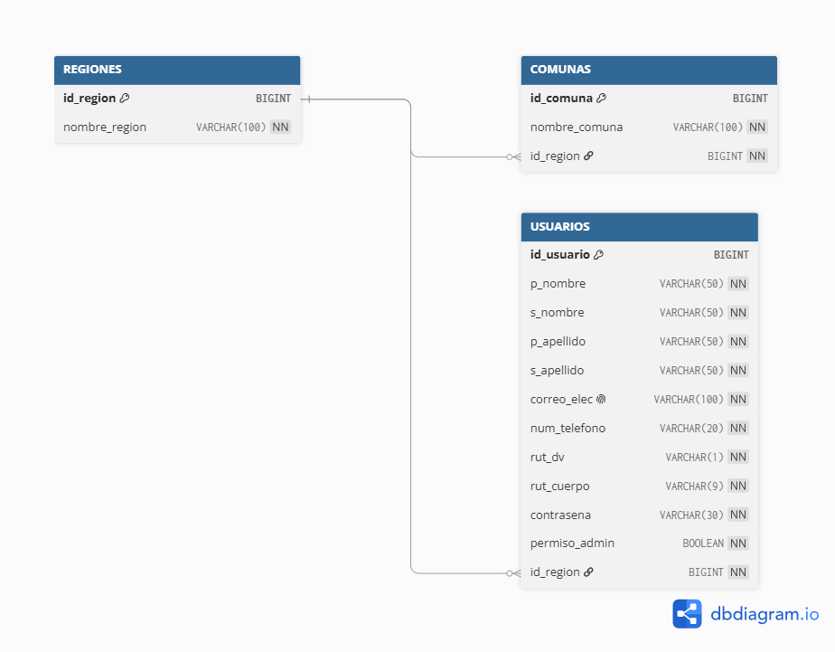
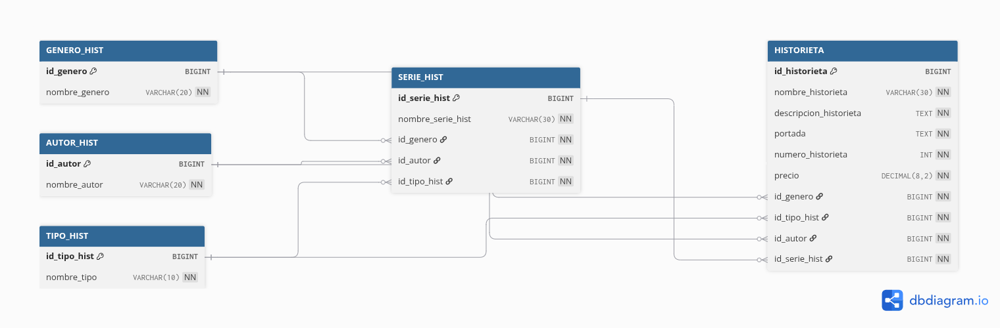
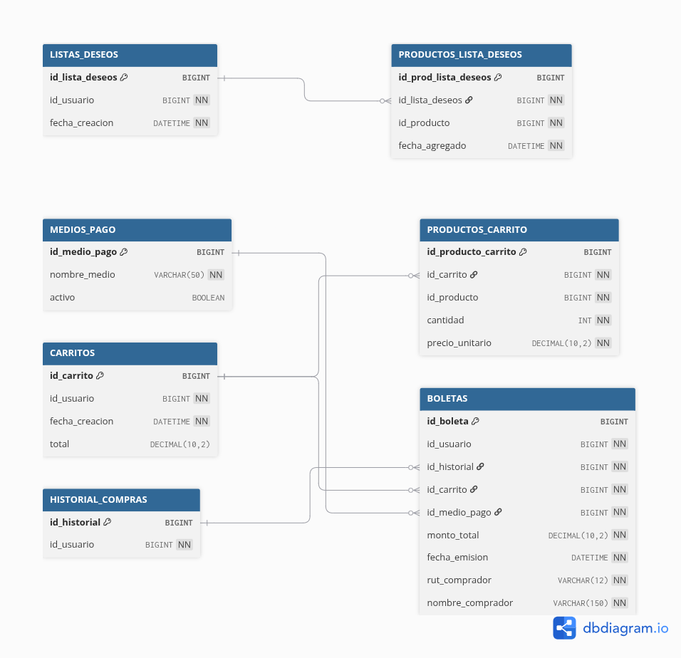
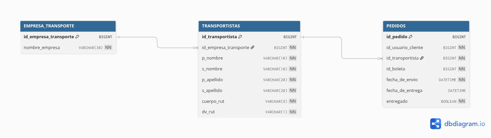

# Sistema de Microservicios — Tienda de Historietas

> Sistema completo de microservicios desarrollado con **Spring Boot** y **Java**, que incluye API Gateway centralizado con autenticación JWT, gestión de usuarios, inventario de historietas, compras y transporte.

---

## 📋 Índice

- [ApiGateway](#apigateway)
- [ApiUsuarios](#apiusuarios)
- [ApiInventario](#apiinventario)
- [ApiCompras](#apicompras)
- [ApiTransporte](#apitransporte)
- [Instrucciones de Acceso](#instrucciones-de-acceso)

---


## 📂 Instrucciones de Acceso a las APIs

> **IMPORTANTE:** Para ingresar a cada una de las APIs, debe navegar a la carpeta **`microservicios`** (ubicada dentro de la carpeta del repositorio de GitHub) para acceder a los submódulos correspondientes.

La estructura general del repositorio es la siguiente:

```text
├── microservicios/    ← Entrar aquí para acceder a las APIs
│   ├── ApiGateway/
│   ├── ApiUsuarios/
│   ├── ApiInventario/
│   ├── ApiCompras/
│   └── ApiTransporte/
├── README.md          ← (este archivo)
```
## Arquitectura de los microservicios 


---

## ApiGateway

> API Gateway centralizado para el sistema de microservicios. Gestiona autenticación JWT, control de acceso y redirección de peticiones hacia los distintos microservicios.

### Arquitectura de Carpetas

```text
ApiGateWay/src/main/java/com/gateway/
├── AuthApiSpringBootApplication.java    → Clase principal Spring Boot
├── config/
│   ├── AppConfig.java                   → Bean RestTemplate con interceptor anti-compresión
│   └── OpenApiConfig.java               → Configuración OpenAPI/Swagger
├── jwt/                                 → Módulo de autenticación
│   ├── controller/
│   │   └── AuthController.java          → Endpoint POST /api/auth/login
│   ├── dto/
│   │   ├── LoginRequest.java            → Body de login (email + password)
│   │   └── AuthResponse.java            → Respuesta con token JWT
│   ├── model/
│   │   └── Usuario.java                → Entidad JPA (tabla USUARIOS)
│   ├── repository/
│   │   └── UsuarioRepository.java       → JPA Repository (findByEmail)
│   ├── security/
│   │   ├── JwtFilter.java              → Filtro que extrae y valida el token
│   │   ├── JwtUtil.java                → Generación y parseo de JWT
│   │   ├── JwtAuthorizationHelper.java  → Helper para validar admins en proxies
│   │   ├── SecurityConfig.java          → Cadenas de seguridad y rutas públicas
│   │   ├── PublicRoutes.java           → Rutas JWT públicas (login, ping)
│   │   ├── UserDetailsImpl.java        → Adaptador UserDetails desde Usuario
│   │   ├── UserDetailsServiceImpl.java  → Carga usuario desde BD
│   │   └── GlobalExceptionHandler.java  → Manejador global de errores
│   └── service/
│       ├── AuthService.java             → Lógica de login
│       └── JwtService.java              → Extracción de claims
└── redireccionApis/                    → Redirecciones a microservicios
    ├── ApiUsuarios/                     → usuarios, regiones, comunas
    ├── ApiInventarios/                  → autor, genero, historieta, serie, tipo
    ├── ApiCompras/                      → boletas, carritos, historial, listaDeseos, mediosPago, productoCart, productoListaDeseos
    └── ApiTransporte/                   → empresaTransporte, pedidos, transportistas
```

### Endpoints de Controlador

| Recurso | Ruta base | Métodos |
|---|---|---|
| Autenticación | `/api/auth/login` | POST |
| Proxy Usuarios | `/api/proxy/usuariosApi` | GET, POST, PUT, DELETE |
| Proxy Regiones | `/api/proxy/regionesApi` | GET, POST, PUT, DELETE |
| Proxy Comunas | `/api/proxy/comunasApi` | GET, POST, PUT, DELETE |
| Proxy Inventario | `/api/proxy/autorHistApi`, `/api/proxy/generoHistApi`, `/api/proxy/historietaApi`, `/api/proxy/serieHistApi`, `/api/proxy/tipoHistApi` | GET, POST, PUT, DELETE |
| Proxy Compras | `/api/proxy/boletasApi`, `/api/proxy/carritosApi`, `/api/proxy/historialComprasApi`, `/api/proxy/ListaDeseosApi`, `/api/proxy/mediosPagoApi`, `/api/proxy/ProductoCartApi`, `/api/proxy/productoListaDeseosApi` | GET, POST, PUT, DELETE |
| Proxy Transporte | `/api/proxy/EmpresaTransporteApi`, `/api/proxy/PedidosApi`, `/api/proxy/TransportistasApi` | GET, POST, PUT, DELETE |

### Diagrama de Base de datos

| Tabla | Descripción |
|---|---|
| `USUARIOS` | Usuarios del sistema con autenticación |

---

### Autorización y Seguridad JWT

El Gateway implementa seguridad centralizada a través de **JWT (JSON Web Tokens)**:

- **Flujo de Login:** El cliente envía credenciales a `POST /api/auth/login`, el cual valida con BCrypt y genera un token JWT con claims: `sub` (email), `username` (email), `userId` (id de BD) y `permiso_admin` (boolean).

- **Filtro JWT (`JwtFilter`):** Intercepta todas las peticiones, extrae el token del header `Authorization: Bearer <token>` y lo valida antes de permitir el acceso.

- **ProxyControllers con validación de permisos:** Cada proxy reconstruye la URL del microservicio destino y valida permisos según el método HTTP y la entidad antes de reenviar la petición.

- **Tabla de permisos:**
  - **GET** endpoints: ✅ Acceso general (todos los usuarios autenticados)
  - **POST/PUT/DELETE** endpoints: 🔒 Requieren `permiso_admin = true` en el token JWT
  - **Excepción:** PUT y DELETE en `/api/proxy/usuariosApi` están permitidos si el `id` coincide con el `userId` del token o si el usuario es admin

---

## ApiUsuarios

> Microservicio de gestión de usuarios, regiones y comunas para una tienda de historietas.

### Arquitectura de Carpetas

```text
api_usuarios/
└── api_usuarios/
    ├── pom.xml
    └── src/main/
        ├── resources/
        │   └── application.properties  # Puerto, conexión MySQL y configuración JPA
        └── java/com/example/api_usuarios/
            ├── ApiUsuariosApplication.java
            ├── Controller/             # Endpoints REST
            ├── Service/                # Interfaces con el contrato de la lógica de negocio
            ├── ServiceImpl/            # Implementación de la lógica de negocio
            ├── Repository/             # Interfaces Spring Data JPA
            ├── Model/                  # Entidades JPA (tablas)
            ├── DTO/                    # DTOs y Mappers por entidad
            │   └── usuarioDTO/         # DTOs de usuario (GET, POST, PUT, Admin)
            ├── RestClient/             # Comunicación con otros microservicios
            │   ├── RestClientConfig.java
            │   ├── CrearCarritoDTO.java
            │   └── CrearListaDeDeseosDTO.java
            └── Seguridad/              # Configuración de Spring Security
                └── SecurityConfig.java
```

### Endpoints de Controlador

| Recurso | Ruta base | Métodos |
|---|---|---|
| Usuarios | `/api/usuariosApi` | GET, POST, PUT, DELETE |
| Regiones | `/api/regionesApi` | GET, POST, PUT, DELETE |
| Comunas | `/api/comunasApi` | GET, POST, PUT, DELETE |

### Diagrama de Base de datos



Relaciones principales:
- `COMUNAS` N ──► 1 `REGIONES` (relación física por `id_region`)
- `USUARIOS` N ──► 1 `REGIONES` (relación física por `id_region`)
- `USUARIOS` N ──► 1 `COMUNAS` (relación física por `id_comuna`)

---

### Autorización a través de DTO y Seguridad

- **DTOs y Mappers:** Se utilizan DTOs diferenciados por operación (`GET`, `POST`, `PUT`, `Admin`) para controlar exactamente qué información se expone en cada endpoint. El DTO `Admin` permite ver y editar información sensible (como la contraseña encriptada).

- **Spring Security con BCryptPasswordEncoder:** Las contraseñas se almacenan de forma segura usando hashing BCrypt. El campo `permiso_admin` determina si el usuario tiene privilegios administrativos.

- **Endpoints `/admin`:** Permiten ver y editar usuarios con información sensible (como la contraseña encriptada). Estos endpoints están protegidos y requieren permisos de administrador.

- **Comunicación con otros microservicios vía RestClient:** Al registrar un nuevo usuario, se crea automáticamente un carrito y una lista de deseos asociados mediante peticiones HTTP al microservicio de compras (puerto 8081).

- **CSRF deshabilitado:** Permite peticiones POST/PUT sin token CSRF.

---

## ApiInventario

> Microservicio de gestión de inventario para una tienda de historietas. Gestiona autores, géneros, historietas, series y tipos.

### Arquitectura de Carpetas

```text
api_inventario/
└── api_inventario/
    ├── pom.xml
    └── src/main/
        ├── resources/
        │   └── application.properties  # Puerto, conexión MySQL y configuración JPA
        └── java/com/example/api_inventario/
            ├── ApiInventarioApplication.java
            ├── Controller/             # Endpoints REST
            ├── Service/                # Interfaces con el contrato de la lógica de negocio
            ├── ServiceImpl/            # Implementación de la lógica de negocio
            ├── Repository/             # Interfaces Spring Data JPA
            ├── Model/                  # Entidades JPA (tablas)
            └── DTO/                    # DTOs y Mappers por entidad
```

### Endpoints de Controlador

| Recurso | Ruta base | Métodos |
|---|---|---|
| Autor | `/api/autorHistApi` | GET, POST, PUT, DELETE |
| Género | `/api/generoHistApi` | GET, POST, PUT, DELETE |
| Historieta | `/api/historietaApi` | GET, POST, PUT, DELETE |
| Serie | `/api/serieHistApi` | GET, POST, PUT, DELETE |
| Tipo | `/api/tipoHistApi` | GET, POST, PUT, DELETE |

### Diagrama de Base de datos



---

### Autorización y Seguridad

- **DTOs y Mappers:** Todos los microservicios utilizan DTOs transversales para transferir datos limpios entre capas sin exponer el Modelo directamente, facilitando el cuerpo en las peticiones y protegiendo la integridad de los datos.

- **Autorizacion JWT centralizada:** La seguridad se maneja a través del API Gateway, donde se valida el token JWT y los permisos de administrador antes de redigir las peticiones al microservicio.

---

## ApiCompras

> Microservicio de gestión de compras para una tienda de historietas. Gestiona carritos, listas de deseos, medios de pago, boletas e historial de compras.

### Arquitectura de Carpetas

```text
api_compras/
├── Base de datos/
│   └── compras_bda.txt                 # Script SQL de la base de datos
└── api_compras/
    ├── pom.xml
    └── src/main/
        ├── resources/
        │   └── application.properties  # Puerto, conexión MySQL y configuración JPA
        └── java/com/example/api_compras/
            ├── ApiComprasApplication.java
            ├── Controller/             # Endpoints REST
            ├── Service/                # Interfaces con el contrato de la lógica de negocio
            ├── ServiceImpl/            # Implementación de la lógica de negocio
            ├── Repository/             # Interfaces Spring Data JPA
            ├── Model/                  # Entidades JPA (tablas)
            ├── DTO/                    # DTOs y Mappers por entidad
            │   ├── BoletaDTO/
            │   ├── CarritoDTO/
            │   ├── HistorialComprasDTO/
            │   ├── ListaDeseosDTO/
            │   ├── ProductoCarritoDTO/
            │   ├── ProductoListaDeseosDTO/
            │   └── RestClientDTO/      # DTOs de las respuestas de microservicios externos
            └── RestClient/             # Comunicación con otros microservicios
                ├── RestClientConfig.java
                ├── UsuarioClient.java
                └── HistorietaClient.java
```

### Endpoints de Controlador

| Recurso | Ruta base | Métodos |
|---|---|---|
| Carritos | `/api/carritosApi` | GET, POST, PUT, DELETE |
| Productos del carrito | `/api/ProductoCartRequest` | GET, POST, PUT, DELETE |
| Listas de deseos | `/api/ListaDeseosApi` | GET, POST, PUT, DELETE |
| Productos de la lista de deseos | `/api/productoListaDeseosRequest` | GET, POST, DELETE |
| Medios de pago | `/api/mediosPagoApi` | GET, POST, PUT, DELETE |
| Boletas | `/api/boletas` | GET, POST, DELETE |
| Historial de compras | `/api/historialCompras` | GET, POST |

### Diagrama de Base de datos



Relaciones principales:
- `HISTORIAL_COMPRAS` 1 ──► N `BOLETAS` (relación física por `id_historial`)
- `MEDIOS_PAGO` 1 ──► N `BOLETAS` (relación física por `id_medio_pago`)
- `CARRITOS` 1 ──► N `PRODUCTOS_CARRITO` y `CARRITOS` 1 ──► N `BOLETAS`
- `LISTAS_DESEOS` 1 ──► N `PRODUCTOS_LISTA_DESEOS`
- `id_usuario` e `id_producto` son **referencias lógicas** a otros microservicios (usuarios e historietas), no tienen llave foránea en esta base de datos.

---

### Autorización a través de DTO y Seguridad

- **DTOs por entidad:** Cada entidad tiene su propio conjunto de DTOs y Mappers para controlar el flujo de datos: `BoletaDTO`, `CarritoDTO`, `HistorialComprasDTO`, `ListaDeseosDTO`, `ProductoCarritoDTO`, `ProductoListaDeseosDTO`.

- **RestClientDTO:** DTOs especializados (`UsuarioExternoDTO`, `HistorietaExternoDTO`) para manejar las respuestas de microservicios externos.

- **Comunicación inter-servicio vía RestClient:** El microservicio consulta a los servicios de usuarios (puerto 8080) e historietas (puerto 8083) para enriquecer las respuestas. Los DTOs externos se combinan con los datos locales para entregar información completa al cliente.

- **Autorizacion JWT centralizada:** La seguridad se maneja a través del API Gateway, donde se valida el token JWT y los permisos de administrador antes de redirigir las peticiones al microservicio.

---

## ApiTransporte

> Microservicio de gestión de transporte y pedidos. Gestiona empresas de transporte, transportistas y pedidos con seguimiento de entregas.

### Arquitectura de Carpetas

```text
api_transporte/
├── Base de datos/
│   └── transporte_dba.sql               # Script SQL de la base de datos
└── api_transporte/
    ├── pom.xml
    └── src/main/
        ├── resources/
        │   └── application.properties  # Puerto, conexión MySQL y configuración JPA
        └── java/com/example/api_transporte/
            ├── ApiTransporteApplication.java
            ├── Controller/             # Endpoints REST
            ├── Service/                # Interfaces con el contrato de la lógica de negocio
            ├── ServiceImpl/            # Implementación de la lógica de negocio
            ├── Repository/             # Interfaces Spring Data JPA
            ├── Model/                  # Entidades JPA (tablas)
            ├── DTO/                    # DTOs y Mappers por entidad
            └── RestClient/             # Comunicación con otros microservicios
                ├── UsuarioClient.java
                └── BoletaClient.java
```

### Endpoints de Controlador

| Recurso | Ruta base | Métodos |
|---|---|---|
| Empresa de Transporte | `/api/EmpresaTransporteApi` | GET, POST, PUT, DELETE |
| Transportistas | `/api/TransportistasApi` | GET, POST, PUT, DELETE |
| Pedidos | `/api/PedidosApi` | GET, POST, PUT, DELETE |

### Diagrama de Base de datos



Tablas principales:
- **EMPRESA_TRANSPORTE**: Empresas de transporte registradas.
- **TRANSPORTISTAS**: Transportistas asociados a una empresa (FK a EMPRESA_TRANSPORTE).
- **PEDIDOS**: Pedidos asignados a un transportista, con referencias lógicas externas a usuarios y boletas.

---

### Automatización a través de DTO y Mapper

- **Entrada simplificada (savePedidoDTO):** El cliente envía componentes de fecha por separado (`anio`, `mes`, `dia`, `hora`). El Mapper valida rangos y construye automáticamente `LocalDateTime fecha_de_envio` junto con `entregado = false` por defecto.

- **Corroboración automática de entidades externas:** Antes de guardar, el Mapper consulta automáticamente las APIs externas (usuario vía `UsuarioClient`, boleta vía `BoletaClient`) para verificar que los IDs existan. Si no existen, se lanza una excepción con mensaje descriptivo.

- **Salida enriquecida (getPedidosDTO):** Al consultar, el Mapper combina datos de varias fuentes: formatea fechas, construye nombres y apellidos desde la API externa, y construye `rut_completo` desde la API de usuarios.

- **PUT inteligente (putPedidoDTO):** Para marcar un pedido como entregado, el cliente envía únicamente `{ "entregado": 1 }`. El Mapper setea automáticamente `fecha_de_entrega` con `LocalDateTime.now()`.

- **Autorizacion JWT centralizada:** La seguridad se maneja a través del API Gateway, donde se valida el token JWT y los permisos de administrador antes de redigir las peticiones al microservicio.
